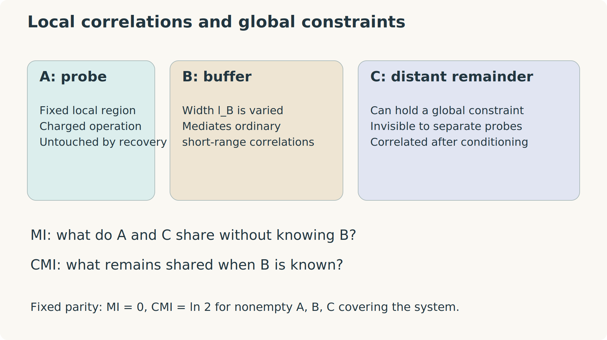

# Information, distinguishability, and recovery {#sec-information}

## Why ordinary expectation values are not enough

The density matrix contains all measurable probabilities, but different functions of it ask different questions. An expectation value is linear in $\rho$. Entropy, fidelity, and conditional mutual information are nonlinear. Measuring such quantities usually requires repeated preparations, multiple copies, controlled preparation access, or structural assumptions. Nonlinearity is not a violation of quantum mechanics; it is a statement about how data from many preparations are combined.

This chapter develops the information quantities used to define mixed-state order. All logarithms are natural unless explicitly marked $\log_2$. Entropies are therefore in nats; dividing by $\ln2$ converts to bits. Fidelity throughout the book is the unsquared, or root, fidelity.

## Entropy and correlations

For eigenvalues $\lambda_a$ of a density matrix,

$$
S(\rho)=-\operatorname{Tr}(\rho\ln\rho)=-\sum_a\lambda_a\ln\lambda_a,
$$

with $0\ln0=0$. It vanishes for pure states and is bounded above by $\ln d$. The Rényi entropies are

$$
S_\alpha(\rho)=\frac1{1-\alpha}\ln\operatorname{Tr}\rho^\alpha,\qquad \alpha>0,\ \alpha\ne1.
$$

Taking $\alpha\to1$ gives $S$. In particular $S_2=-\ln\operatorname{Tr}\rho^2$. The label “Rényi-1 correlator” used later refers to a canonical-purification construction, not to substituting $\alpha=1$ into a purity denominator.

For a classical joint distribution, the conditional entropy $H(A|B)=H(AB)-H(B)$ measures residual uncertainty in $A$ after $B$ is known. Quantum conditional entropy $S(A|B)=S(AB)-S(B)$ can be negative: a Bell pair has $S(AB)=0$ and $S(B)=\ln2$. This is one reason not to interpret every quantum entropy difference as an ordinary classical ignorance.

The mutual information is

$$
I(A:C)=S(A)+S(C)-S(AC).
$$ {#eq-mutual-info}

It is nonnegative and vanishes exactly when $\rho_{AC}=\rho_A\otimes\rho_C$. It captures both quantum and classical correlations. A classical coin shared by two sites has $I=\ln2$ without entanglement. A Bell pair has $I=2\ln2$.

## Relative entropy and data processing

Quantum relative entropy is

$$
D(\rho\|\sigma)=\operatorname{Tr}\rho(\ln\rho-\ln\sigma),
$$

provided $\operatorname{supp}\rho\subseteq\operatorname{supp}\sigma$; otherwise it is infinite. It is nonnegative and zero exactly for identical states. It is not symmetric and is not a metric.

An important identity is

$$
I(A:C)=D(\rho_{AC}\|\rho_A\otimes\rho_C).
$$

It follows by using $\ln(\rho_A\otimes\rho_C)=\ln\rho_A\otimes I+I\otimes\ln\rho_C$ and taking partial traces.

Relative entropy decreases under every channel:

$$
D(\mathcal E\rho\|\mathcal E\sigma)\leq D(\rho\|\sigma).
$$ {#eq-relative-dpi}

This data-processing inequality says that forgetting or processing information cannot improve optimal statistical discrimination between two hypotheses. The inequality is a nontrivial matrix theorem; its operational direction is worth fixing before we use analogous statements for fidelity.

For density matrices, quantum Pinsker's inequality in natural-log convention is $D(\rho\|\sigma)\geq\frac12\|\rho-\sigma\|_1^2$. Since $|\operatorname{Tr}(XA)|\leq\|X\|_1\|A\|_\infty$, it implies for unit-norm local operators

$$
|\langle A_AC_C\rangle_c|\leq\sqrt{2I(A:C)}.
$$

Thus a nondecaying ordinary connected correlation requires nonzero distant mutual information. The converse does not identify a particular order parameter, since MI combines all correlations.

## Trace distance and fidelity

The trace norm is $\|A\|_1=\operatorname{Tr}\sqrt{A^\dagger A}$. The trace distance is

$$
T(\rho,\sigma)=\frac12\|\rho-\sigma\|_1.
$$

For equal prior probabilities, optimal one-shot discrimination succeeds with probability $(1+T)/2$. Root fidelity is

$$
F(\rho,\sigma)=\operatorname{Tr}\sqrt{\sqrt\rho\,\sigma\sqrt\rho}
=\|\sqrt\rho\sqrt\sigma\|_1.
$$ {#eq-root-fidelity}

For normalized states, $0\leq F\leq1$. It equals one exactly when the states coincide and zero exactly when their supports are orthogonal. For two pure states it is $|\langle\psi|\phi\rangle|$. Some papers use its square as “fidelity”; their exponents and bounds must be translated before comparing formulas.

If $\rho$ and $\sigma$ commute, diagonalize them together. Then

$$
F(\rho,\sigma)=\sum_a\sqrt{p_aq_a}.
$$ {#eq-classical-fidelity}

This is the classical Bhattacharyya overlap. It is the central computational shortcut in several solvable SW-SSB models.

Fidelity and trace distance obey

$$
1-F(\rho,\sigma)\leq T(\rho,\sigma)
\leq\sqrt{1-F(\rho,\sigma)^2}.
$$ {#eq-fvdg}

Fidelity increases under channels: $F(\mathcal E\rho,\mathcal E\sigma)\geq F(\rho,\sigma)$. The direction is opposite to distinguishability: two states become more similar when information is discarded.

### Purification derivation of the fidelity formula

All purifications of $\rho$ in a sufficiently large environment are related by an environment isometry. Using the vectorization identity from Chapter 1, their overlaps with a purification of $\sigma$ can be written as $\operatorname{Tr}(\sqrt\rho\sqrt\sigma\,V)$ for an appropriate unitary $V$ on the support. The polar decomposition $A=W|A|$ gives

$$
\max_{V\ {
m unitary}}|\operatorname{Tr}(AV)|=\operatorname{Tr}|A|.
$$

Indeed the choice $V=W^\dagger$ attains the trace norm, and the upper bound follows from $|\operatorname{Tr}(AV)|\leq\|A\|_1\|V\|_\infty$. Setting $A=\sqrt\rho\sqrt\sigma$ yields Uhlmann's characterization: fidelity is the largest overlap of purifications. A common channel dilation followed by discarding part of the environment cannot reduce that available maximum, explaining fidelity monotonicity.

This does not mean that an arbitrary physical purification has the maximizing overlap. Optimizing over the environment is precisely what makes fidelity a property of $\rho,\sigma$, independent of a particular preparation.

### Worked example: flipping a biased classical bit

For $\rho=p\ket0\bra0+(1-p)\ket1\bra1$, let $\sigma=X\rho X$. Then

$$
F(\rho,X\rho X)=2\sqrt{p(1-p)},\qquad
T(\rho,X\rho X)=|2p-1|.
$$

A pure classical bit is orthogonal to its flip. A maximally uncertain bit is unchanged by flipping. Large overlap after a charge transfer can therefore signal delocalized or erased charge information without any ordinary ordered expectation value.

## A fidelity average is not a linear expectation value

For a unitary $A$, define $F_A=F(\rho,A\rho A^\dagger)$. The identity

$$
F_A=\|\sqrt\rho A\sqrt\rho\|_1
\geq|\operatorname{Tr}(\rho A)|
$$ {#eq-fidelity-average-bound}

follows from the trace-norm bound. For a pure state equality holds. For a mixed state it can be strict: $\rho=I/2$ and $A=Z$ give $F_A=1$ but $\operatorname{Tr}(\rho Z)=0$.

For a nonunitary $A$, $A\rho A^\dagger$ may have trace different from one. There are two distinct choices: use the same algebraic homogeneous overlap on positive operators, or normalize the postselected output and separately track its success probability. They need not agree. Unless explicitly stated, worked fidelity comparisons in this book use unitary charge-transfer operators. Ladder-operator examples state their normalization explicitly.

Fidelity alone does not establish SW-SSB. The maximally mixed state has $F_A=1$ for every unitary but has no fixed global strong charge. The symmetry assumption, absence of conventional order, and long-distance limit are all part of the definition.

## Conditional mutual information

Partition the complete system into a region $A$, a buffer $B$, and a distant remainder $C$. The conditional mutual information is

$$
I(A:C|B)=S(AB)+S(BC)-S(B)-S(ABC).
$$ {#eq-cmi}

Equivalently it is $I(A:BC)-I(A:B)$. Strong subadditivity states $I(A:C|B)\geq0$. Unlike ordinary mutual information, CMI asks whether knowing the buffer exhausts the correlation with the rest.

{#fig-information-regions width=95%}

For a pure state of all $ABC$, $S(AB)=S(C)$, $S(BC)=S(A)$, and $S(B)=S(AC)$, so $I(A:C|B)=I(A:C)$. Their distinction is intrinsically mixed-state physics.

### Exact comparison: three kinds of Ising order

Take nonempty $A,B,C$ covering $N$ qubits.

For the classical coin of all-up and all-down configurations, every nonempty reduced state has entropy $\ln2$. Thus $I(A:C)=\ln2$ but $I(A:C|B)=0$: the bit in $B$ already tells us the orientation.

For the pure cat, every proper nonempty reduced state has entropy $\ln2$, while the full entropy vanishes. Thus both MI and CMI equal $\ln2$.

For the parity state $\rho_+=(I+\prod_iX_i)/2^N$, every proper region $R$ has entropy $|R|\ln2$, while the full entropy is $(N-1)\ln2$. Hence

$$
I(A:C)=0,\qquad I(A:C|B)=\ln2.
$$ {#eq-parity-cmi}

Every ordinary distant correlation is absent, yet conditioning on the buffer exposes one global constraint. In the $X$ basis this is simply a uniform collection of bits with even total parity. Given all the other bits, the parity of $A$ determines the parity of $C$.

| State | Distant MI | Buffered CMI | Information carried |
|:--|:--:|:--:|:--|
| Product state | $0$ | $0$ | No shared bit |
| Classical Ising coin | $\ln2$ | $0$ | A locally readable common orientation |
| Pure Ising cat | $\ln2$ | $\ln2$ | Orientation and global coherence |
| Fixed-parity maximally mixed state | $0$ | $\ln2$ | A global charge constraint |

These are representative examples, not an exhaustive classification of every state by two numbers.

## Recovery maps and the Markov property

Suppose $C$ is erased, leaving $\rho_{AB}$. Can a map acting only on $B$ append a new $C$ and reconstruct the original correlations with untouched $A$? Exact quantum Markov states have $I(A:C|B)=0$ and admit such a recovery map.

For a compatible state the Petz candidate is

$$
\mathcal R^{\mathrm{P}}_{B\to BC}(X_B)
=\rho_{BC}^{1/2}
\left(\rho_B^{-1/2}X_B\rho_B^{-1/2}\otimes I_C\right)
\rho_{BC}^{1/2}.
$$ {#eq-petz-foundation}

Inverse square roots are taken on the support. The map can be extended trace preservingly outside that support. It satisfies $\mathcal R^{\mathrm{P}}(\rho_B)=\rho_{BC}$, but that identity alone does not establish recovery of correlations with $A$. Exact recovery holds under the Markov condition. For approximate recovery, an appropriately optimized or rotated recovery map is generally needed; the plain Petz map should not automatically be assigned every sharp bound.

The Fawzi-Renner theorem establishes the existence of a CPTP map with [@fawzi2015]

$$
F\left(\rho_{ABC},(\mathrm{id}_A\otimes\mathcal R_{B\to BC})(\rho_{AB})\right)
\geq e^{-I(A:C|B)/2}.
$$ {#eq-recovery-bound}

Thus small CMI guarantees good recovery. A nonzero CMI is not, by itself, a quantitative proof that every recovery has small fidelity. To establish an obstruction, one may separately upper-bound all possible recovery fidelities; combining that bound with @eq-recovery-bound yields a lower bound on CMI.

### Worked example: why parity cannot be recovered locally

Erase nonempty $C$ from $\rho_+$. The input $\rho_{AB}=I_A/2^{|A|}\otimes I_B/2^{|B|}$ is a product across $A|B$. Any channel on $B$ produces $I_A/2^{|A|}\otimes\tau_{BC}$. It cannot correlate the parity of $A$ with $BC$.

Measure full parity $U_AU_BU_C$. Since $\langle U_A\rangle=0$ in the unchanged maximally mixed $A$, its two outcomes are equiprobable in every recovered state. The target has even parity with probability one. Monotonicity of fidelity under this measurement gives

$$
F(\rho_+,\rho_{\mathrm{rec}})\leq\frac1{\sqrt2}.
$$

The bound is attained by the fully maximally mixed recovered state. Combining it with the recovery theorem requires $I\geq\ln2$, saturated by @eq-parity-cmi. The obstruction concerns correlation with untouched $A$, not an inability to prepare a parity constraint if allowed to act globally.

## Information lengths and geometry

If $I(A:C)$ decays as $e^{-\ell_B/\xi_c}$, $\xi_c$ is an information correlation length. If $I(A:C|B)$ decays as $e^{-\ell_B/\xi_M}$ in a specified family of partitions, $\xi_M$ is a Markov length. The geometry and prefactors matter. A bound proportional to $|C|e^{-\ell_B/\xi_M}$ does not remain small when $|C|$ is taken to infinity before the buffer grows.

Long-range CMI can arise from global charge constraints, topological structure, or other forms of conditional organization. It is not a unique signature of SW-SSB. Conversely, the implication from SW-SSB to long-range CMI uses the appropriate global or local formulation and its assumptions; it is not merely a resemblance between the parity example and an arbitrary state.

## Exercises and worked solutions

### 1. Fidelity of commuting distributions

For two independent classical bits with distributions $p\otimes p$ and $q\otimes q$, prove that their root fidelity is the square of the single-bit fidelity. Generalize to $N$ bits.

::: {.callout-note collapse="true" title="Solution"}
The sum factorizes: $\sum_{ab}\sqrt{p_ap_bq_aq_b}=(\sum_a\sqrt{p_aq_a})^2$. For $N$ bits it is $F(p,q)^N$. Two locally very similar distributions with single-bit fidelity below one can become globally nearly orthogonal. This elementary extensivity is a warning against equating global overlap with local similarity.
:::

### 2. Root fidelity versus squared fidelity

If another convention defines $\mathfrak F=F^2$, rewrite the recovery bound and the trace-distance upper bound.

::: {.callout-note collapse="true" title="Solution"}
They become $\mathfrak F(\rho,\rho_{\mathrm{rec}})\geq e^{-I}$ and $T\leq\sqrt{1-\mathfrak F}$. A factor of two in an exponent may reflect convention rather than a scientific disagreement. Check definitions before comparing threshold scaling or susceptibility formulas.
:::

### 3. A classical conditional correlation

Let $a,b$ be independent uniform bits and $c=a\oplus b$. Compute $I(a:c)$ and $I(a:c|b)$ in bits.

::: {.callout-note collapse="true" title="Solution"}
Each pair of variables is uniform on four outcomes, so $H(a)=H(c)=1$ and $H(ac)=2$, giving $I(a:c)=0$. The full distribution has four outcomes, hence $H(abc)=2$. With $H(ab)=H(bc)=2$ and $H(b)=1$, CMI is one bit. This is the smallest parity model of hidden conditional information.
:::

### 4. Pure-state MI equals CMI

Prove the equality for a pure state on $ABC$, and explain why it fails for the parity ensemble.

::: {.callout-note collapse="true" title="Solution"}
Schmidt decomposition across each bipartition gives $S(AB)=S(C)$, $S(BC)=S(A)$, $S(B)=S(AC)$, and $S(ABC)=0$. Substitution gives equality. The parity state has nonzero full entropy and no such complement-entropy identities. Its vanishing MI and nonzero CMI demonstrate that mixedness creates an independent kind of information structure.
:::

### 5. Recovery directions

Does a state admitting a good recovery map necessarily have small CMI independent of dimension? What can safely be concluded from @eq-recovery-bound alone?

::: {.callout-note collapse="true" title="Solution"}
The displayed theorem states a sufficient condition: small CMI implies existence of good recovery. Its logical converse does not follow. A lower bound on the best fidelity also does not upper-bound CMI. To bound CMI from below, establish that every allowed recovery has fidelity at most $f_*<1$; then $e^{-I/2}\leq f_*$ gives $I\geq-2\ln f_*$. Converse estimates require additional results and may involve dimensions or other assumptions.
:::
