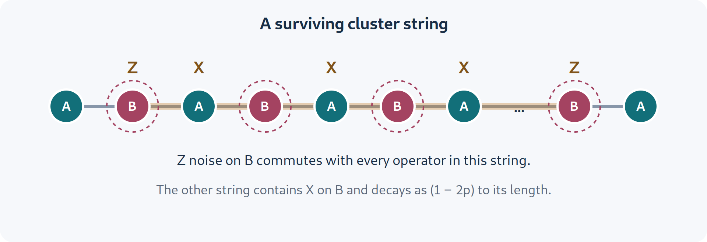

# Mixed-state SPT order, boundaries, and anomalies {#sec-mixed-spt}

An ordinary paramagnet and a one-dimensional cluster state have short-ranged bulk correlations. Nevertheless, if an appropriate symmetry must be preserved, they cannot be smoothly connected while keeping a unique gapped ground state. A boundary reveals the difference: it carries degrees of freedom on which the symmetry acts projectively. These are symmetry-protected topological, or SPT, phases.

The mixed-state question is subtler. Part of a protecting symmetry may remain strong while another part becomes weak. Some string correlations survive, some information becomes classical, and doubled-space diagnostics can retain structure after ordinary correlations have disappeared. To understand these statements, we first derive a pure cluster state's protection and then perform a dephasing channel exactly. This also gives an example of why nonzero string order, quantum entanglement, SW-SSB, and robustness of a Lindblad steady state must be distinguished.

## A pure SPT state from commuting operators {#sec-cluster-pure}

On a chain of qubits define

$$
K_j=Z_{j-1}X_jZ_{j+1}.
$$

Neighboring $K_j$ share two anticommuting Pauli pairs; the minus signs cancel, so all $K_j$ commute. On a ring their common $+1$ eigenstate is the cluster state $|C\rangle$, the unique ground state of $H_C=-\sum_jK_j$.

For an even-length ring, split the sites into two sublattices and define

$$
G_A=\prod_{j\in A}X_j,\qquad
G_B=\prod_{j\in B}X_j.
$$

The neighboring $Z$ factors cancel in a product over one sublattice, giving $G_A=\prod_{j\in A}K_j$ and similarly for $G_B$. Thus $G_A|C\rangle=G_B|C\rangle=|C\rangle$. Both symmetries are strong.

There is a finite-depth unitary preparation. Begin with $|+\rangle$ on every site and apply a controlled-$Z$ gate on every bond. The gate is diagonal, with entries $(1,1,1,-1)$ in the computational basis, and conjugates $X_j$ to $K_j$. Two bond layers suffice. Hence the cluster state is short-range entangled when symmetry is ignored. Its nontriviality concerns symmetric deformations, not an impossibility of preparing it with any shallow circuit.

### Deriving the edge projective representation

Open a chain of even length $N$, retain $K_2,\ldots,K_{N-1}$, and omit boundary stabilizers. There are two unconstrained qubits. Operators for the left one can be chosen as

$$
\overline Z_L=Z_1,\qquad \overline X_L=X_1Z_2;
$$

the right ones are $\overline Z_R=Z_N$, $\overline X_R=Z_{N-1}X_N$. These commute with all retained stabilizers, while the two operators on the same edge anticommute. Within the ground space, multiply each global symmetry by suitable bulk stabilizers to obtain

$$
G_A\simeq\overline X_L\overline Z_R,
\qquad
G_B\simeq\overline Z_L\overline X_R,
$$ {#eq-spt-edge-fractionalization}

where $A$ denotes odd sites in this formula. The two global symmetries commute, but their left-edge factors anticommute. This is a projective representation: the group multiplication law holds up to phases at a single edge, and the opposite edge cancels the phase for the entire system.

A local Hamiltonian on the left edge that respects both independent edge Pauli actions must be proportional to identity. Indeed, an operator $aI+bX+cY+dZ$ commuting with both $X$ and $Z$ has $b=c=d=0$. A symmetry-preserving local perturbation therefore cannot lift that edge degeneracy on its own. Coupling the two distant edges can split it, but a local gapped bulk makes that coupling exponentially small with length.

This edge algebra is a concrete version of a cohomological SPT invariant. For a general group $G$, edge operators obey $V_gV_h=\omega(g,h)V_{gh}$. Associativity requires the two-cocycle equation $\omega(g,h)\omega(gh,k)=\omega(h,k)\omega(g,hk)$. Rephasing $V_g$ changes $\omega$ by a coboundary. The equivalence class, rather than a particular phase convention, labels the projective action. For the cluster state's $\mathbb Z_2\times\mathbb Z_2$, the anticommutator above is the nontrivial invariant.

## Strings expose hidden bulk order {#sec-cluster-strings}

Relabel the ring as alternating sites $a_i,b_i$, $i=1,\ldots,L$, with

$$
K^A_i=Z^B_{i-1}X^A_iZ^B_i,
\qquad
K^B_i=Z^A_iX^B_iZ^A_{i+1}.
$$ {#eq-spt-cluster-stabilizers}

Products telescope:

$$
\mathcal S_A(i,j)=\prod_{k=i}^jK^A_k
=Z^B_{i-1}\left(\prod_{k=i}^jX^A_k\right)Z^B_j.
$$ {#eq-spt-string}

Its expectation is one in $|C\rangle$, independent of length. A similar $B$ string has $Z^A$ endpoints. Ordinary $Z$ two-point functions vanish at long distance. The string compensates for a fluctuating symmetry charge in the interior, leaving endpoint information.

The endpoint charge is the important feature: a truncated $A$ symmetry operation leaves $B$-charged endpoint operators. This is a decorated-defect picture of SPT order. It provides intuition for why the two symmetries work together. A nonzero string expectation without its symmetry and endpoint transformation properties would not by itself classify an SPT phase.

## Exact sublattice dephasing {#sec-cluster-dephasing}

Apply independent $Z^B_i$ dephasing to the $B$ sites:

$$
\mathcal E_p=\prod_i\mathcal E_{p,i},\qquad
\mathcal E_{p,i}(\rho)=(1-p)\rho+pZ^B_i\rho Z^B_i,
\qquad 0\leq p\leq\tfrac12.
$$ {#eq-spt-dephase-channel}

Every Kraus operator commutes with $G_A=\prod_iX^A_i$, so that symmetry is preserved strongly. A single $Z^B_i$ anticommutes with $G_B=\prod_iX^B_i$, so the channel exchanges $B$ charge with its environment. It is still covariant under $G_B$: the minus sign cancels between the two sides of each Kraus term. Thus $\rho_p=\mathcal E_p(|C\rangle\langle C|)$ has strong $G_A$ and, for generic $p>0$, only weak $G_B$.

The channel acts diagonally on Pauli strings. A Pauli string containing $X$ or $Y$ at $m$ dephased sites is multiplied by $(1-2p)^m$. Therefore

$$
\tr(\rho_p\mathcal S_A(i,j))=1,
\qquad
\tr(\rho_p\mathcal S_B(i,j))=(1-2p)^{j-i+1}.
$$ {#eq-spt-string-attenuation}

The two strings no longer play interchangeable roles. One remains an ordinary linear correlator; the other decays for every $p>0$. This is an exact calculation, not evidence of a finite-noise thermodynamic transition in one dimension.

{#fig-cluster-dephasing width="100%"}

At maximal dephasing, the full stabilizer density matrix simplifies. Terms containing any $K^B_i$ have $X$ or $Y$ on at least one $B$ site and vanish. The surviving state is

$$
\rho_* = 2^{-2L}\prod_{i=1}^{L}(I+K^A_i).
$$ {#eq-spt-decohered-cluster}

The $L$ independent surviving constraints give rank $2^L$ and entropy $L\ln2$. Since their product equals $G_A$, we have $G_A\rho_*=\rho_*$. Conjugation by $G_B$ leaves each $K^A_i$ invariant, but $G_B\rho_*$ is not $\rho_*$. This checks the strong/weak statements directly, without inferring them from terminology.

### Worked example: separability and symmetry protection

Diagonalize the $B$ spins in the $Z$ basis, with values $s_i=\pm1$. The constraints require $X^A_i=s_{i-1}s_i$. Consequently

$$
\rho_* =2^{-L}\sum_{\{s_i\}}
\bigotimes_i|Z^B_i=s_i\rangle\langle Z^B_i=s_i|
\otimes
\bigotimes_i|X^A_i=s_{i-1}s_i\rangle\langle X^A_i=s_{i-1}s_i|.
$$ {#eq-spt-separable-decomposition}

This is a convex mixture of product states, so $\rho_*$ is fully separable. Yet its string relation is exact, and the strong/weak symmetry constrains admissible preparations and reversals. There is no contradiction: a phase distinction under symmetry-restricted operations need not be ordinary entanglement across a spatial cut. Also, this decomposition does not make each component $G_B$ symmetric: $G_B$ sends $s_i\mapsto-s_i$, pairing different members of the ensemble.

This example warns against interpreting every mixed SPT invariant as distillable entanglement. Average-symmetry phases, quantum information retained from a pure SPT, and the operational class of allowed channels must be specified. The systematic distinction between disorder and decoherence was developed in @ma2023average and @ma2025topological; doubled-space treatments provide complementary classifications [@ma2025doubled; @xue2024tensor].

## From the cluster ensemble to SW-SSB {#sec-cluster-to-swssb}

The state $\rho_*$ is not already a featureless parity ensemble on $A$. Its local constraints remember where the $A$ charges sit relative to $B$ spins. A local $Z^A_i$ flips $K^A_i$ and moves the support to an orthogonal constraint sector. Acting with $Z^A_iZ^A_j$ at distinct sites still changes two locally readable constraints, so its fidelity correlator is zero. A strong $G_A$ symmetry alone does not force SW-SSB.

Now maximally dephase every neighboring $A$ pair with the operator $Z^A_iZ^A_{i+1}$. These pair errors commute with $G_A$. A product $\prod_i(K^A_i)^{t_i}$ survives every pair dephasing only if $t_i+t_{i+1}=0$ modulo two on each bond. On a connected ring all $t_i$ are equal. Thus only identity and $\prod_iK^A_i=G_A$ remain:

$$
\rho_{\mathrm{end}}=2^{-2L}(I+G_A).
$$ {#eq-spt-to-parity}

The $B$ sites are maximally mixed, and the $A$ sites form the fixed-parity ensemble. For $i\ne j$, its ordinary $\langle Z^A_iZ^A_j\rangle$ vanishes, while $Z^A_iZ^A_j\rho_{\mathrm{end}}Z^A_iZ^A_j=\rho_{\mathrm{end}}$, so $F=1$. We have explicitly converted constrained cluster-string structure into SW-SSB under a strongly $A$-symmetric channel.

At this endpoint, the old linear string with two $B$ endpoints vanishes: its expectation contains a nontrivial Pauli operator on the maximally mixed $B$ sector. Thus the persistence of a strong symmetry does not guarantee the persistence of the earlier SPT diagnostic. This one-way conversion does not prove equivalence of the initial and final phases under locally reversible symmetric channels.

The endpoint calculation is also consistent with the one-dimensional finite-depth obstruction: a transition can occur at maximal dephasing, where local channel invertibility is lost. It does not demonstrate a generic finite-noise transition under a finite-depth strictly local channel. Long-range channels can change this conclusion, as the later frontier chapters explain.

## Canonical purification and Choi SPT data {#sec-spt-doubled-caveat}

Two different doubled states must be kept distinct. If $\rho=\sum_a\lambda_a|a\rangle\langle a|$, the canonical purification is $|\sqrt\rho\rangle\rangle=\sum_a\sqrt{\lambda_a}|a\rangle|a^*\rangle$. Vectorization instead gives $|\rho\rangle\rangle=\sum_a\lambda_a|a\rangle|a^*\rangle$, which must be normalized by $\sqrt{\tr\rho^2}$.

A strong symmetry acts on ket and bra copies separately, with conjugate characters. A weak symmetry acts diagonally. This makes mixed SPT invariants resemble ordinary SPT invariants for an enlarged group. But a physical density matrix obeys Hermiticity, positivity, and unit trace. An arbitrary pure SPT state in the doubled space need not satisfy those conditions when reshaped into a matrix.

For short-range-correlated, suitably injective tensor-network states with direct-product unitary strong group $G$ and weak group $K$, a useful one-dimensional classification contains the ordinary strong-group projective term and a mixed term,

$$
H^2(G,U(1))\oplus H^1\bigl(K,H^1(G,U(1))\bigr).
$$ {#eq-spt-cohomology}

The second term records a weak-symmetry defect decorated by a strong-symmetry charge. This is a classification within the stated tensor-network assumptions, not a statement that arbitrary mixed density matrices with arbitrary long-range conditional information obey this formula [@xue2024tensor].

Choi-space long-range order naturally involves $R_2$ quantities. A claimed transition derived only there should remain identified as such. Canonical-purification or fidelity statements require their own argument. Even when the fixed-point examples agree, stability under physical channels is an additional question.

### A positive tensor-network representation

Positivity can be built into a numerical representation. Write a purification amplitude as a matrix $T_{s,a}$, where $s$ collects system indices and $a$ collects environment indices. Then

$$
\widetilde\rho_{s,s'}=\sum_aT_{s,a}T^*_{s',a},\qquad
\rho=TT^\dagger/\tr(TT^\dagger).
$$ {#eq-spt-lpdo}

This remains positive for every choice of $T$. If the amplitudes of $T$ are expressed as a matrix product,

$$
T_{\{s_i\},\{a_i\}}=
\tr\left[A^{s_1,a_1}_1 A^{s_2,a_2}_2\cdots A^{s_L,a_L}_L\right],
$$

the auxiliary matrix indices describe bonds between neighboring sites, while $a_i$ is a local purification index. Tracing those local indices gives a locally purified density operator, or LPDO. This is a practical way to avoid unphysical negative eigenvalues that unconstrained truncation of a density-matrix representation can introduce.

A strong symmetry restricts the system support itself; a weak symmetry can instead be implemented by a compensating transformation on the purification indices. Symmetry relations on the virtual bonds can then reveal the projective data. To turn that observation into a phase classification, one needs injectivity conditions: after blocking a bounded number of sites, the tensors must map their virtual boundary data faithfully into physical block data in the specified sense. These hypotheses exclude arbitrary long-range correlations or unbounded hidden information. LPDO classifications and fixed-point constructions establish average-SPT examples for more general symmetry extensions than the direct-product illustration above [@guo2025lpdo]. The tensor ansatz supplies both a positivity guarantee and a domain of applicability; it is not a theorem that every mixed phase has an efficient fixed-bond-dimension description.

## Strange correlators and information access {#sec-spt-strange}

A pure-state strange correlator compares an SPT wavefunction $|\psi\rangle$ with a trivial reference $|\Omega\rangle$:

$$
C_{\mathrm{str}}(i,j)=
\frac{\langle\Omega|O_iO_j^\dagger|\psi\rangle}
{\langle\Omega|\psi\rangle}.
$$

It resembles a correlation function at an interface between the two states. That interface can retain boundary-like long-range or critical structure even when ordinary bulk correlators are short-ranged. Its usefulness depends on the operator, the reference, and a nonzero denominator; it is not a universal correlator for every state without those choices.

Mixed-state extensions can use linear overlaps, replicated overlaps, or fidelity. These differ in which information is accessible and in whether normalization amplifies rare components. Type-I and type-II strange correlators were used to separate operationally accessible SPT information from a fuller doubled-state topological response [@lee2025spt]. Fidelity strange correlators give another bulk route to average-SPT diagnosis [@zhang2026fsc].

A purification offers physical intuition: symmetry defects in the environment can carry information about charge or domain walls in the system. Conditioning on an environment record may reveal a pure ordered state; averaging can hide that order from linear observables. The resulting correspondence depends on a specified local purification or preparation, rather than on a unique environment intrinsic to $\rho$ [@sala2024purification].

## What an anomaly actually constrains {#sec-spt-anomalies}

An anomaly is an obstruction to realizing or gauging a symmetry in a strictly lower-dimensional, local, short-range-trivial manner. The edge anticommutation in @eq-spt-edge-fractionalization is the simplest example. In field theory, a bulk response can cancel the boundary's anomalous variation, called anomaly inflow. On a lattice, one can often diagnose it through the algebra of symmetry operators truncated to intersecting regions.

Mixed-state constraints depend critically on whether the anomalous symmetry is strong. A strong condition restricts every vector in the support, whereas a weak condition only constrains the ensemble. For group-cohomology anomalies of a strong symmetry in $d$ dimensions, @lessa2025anomaly connects the anomaly to long-range multipartite nonseparability: its rigorous arguments cover $d\leq1$, with higher-dimensional extensions supported by plausibility arguments. A mixed strong/weak anomaly can instead constrain recoverability and long-range correlations without forcing quantum entanglement. Our separable cluster ensemble makes that possibility less surprising.

“The boundary cannot be trivial” is therefore incomplete until triviality is defined. It can mean a unique gapped symmetric pure ground state, a short-range-entangled symmetric mixed state, a state with finite correlation and Markov lengths, or a state preparable by a specified symmetric circuit. These are different restrictions. The anomaly must be matched by the degrees of freedom and the operational structure that actually remain.

## State robustness versus steady-state robustness {#sec-spt-steady-stability}

Suppose a density matrix has a protected invariant under a class of locally reversible symmetric deformations. It does not follow that any local Lindbladian with that state as a stationary state has a stable stationary phase. A small perturbation to the generator acts for arbitrarily long times before the steady state is reached. Finite-time stability theorems do not automatically commute with this infinite-time limit.

For decohered cluster states, a parent Lindbladian can be mapped to reaction-diffusion dynamics. Typical allowed perturbations that create the relevant strong-symmetry defects produce SW-SSB at arbitrarily small strength and destabilize its steady-state mixed SPT order. Perturbations creating only weak-symmetry defects can behave differently [@shah2025instability]. The result concerns that family of generators and perturbations; it is not a theorem that every conceivable mixed SPT state is unstable under every symmetric channel.

The distinction is physically instructive. A stationary constraint can rely on defects being absent forever. A tiny creation rate accumulated over infinite time can populate those defects throughout the sample. Whether they retain enough correlations to preserve a string or anomaly diagnostic is then a dynamical question, even if the microscopic perturbation respects the stated covariance.

## Developments through the cutoff {#sec-spt-2026}

The decorated-defect mechanism also runs in the opposite direction: dephasing the charge attached to a defect can induce SW-SSB of the defect's symmetry. Extensions to higher-form, modulated, and gapless SPT settings were developed in @lu2026response. This gives a channel-dependent topological response rather than a single linear-response coefficient.

Extended cluster states with multiple subsystem symmetries can generate a hierarchy of mixed SPT states under successive subsystem decoherence, diagnosed by surviving $R_2$ strings [@kuno2026hierarchy]. Choi-space analyses also distinguish trace-preserving decoherence from no-click postselection: filtering and renormalizing a state can alter the relevant stabilizer support and drive different limiting orders [@kuno2026fate]. These are model-resolved developments; a unified classification of all such hierarchies is not established.

Double-ASPT constructions combine strong-to-weak order with a remaining strong/weak SPT structure [@guo2025double]. SymTFT constructions organize mixed SPTs using folded higher-dimensional topological theories [@qi2025taco; @schafer2025symtft]. They provide useful conceptual maps, while positivity and the particular phase equivalence remain essential constraints.

Experiments on a five-qubit superconducting array probe cluster-string order, selective dephasing, and the difference between conditioned and discarded measurement records [@cao2026mixed]. Such finite-size signatures connect directly to the algebra derived here. Establishing thermodynamic phases additionally requires a controlled family of sizes and an understanding of noise and reconstruction assumptions.

## Exercises and worked solutions {#sec-spt-exercises}

### Exercise 1: check the cluster symmetry

Show directly that $K_j$ commutes with each of $G_A,G_B$, and explain why a one-site $Z$ dephasing channel may preserve covariance while violating strong symmetry.

::: {.callout-note collapse="true" title="Worked solution"}
If $j$ lies on $A$, $G_A$ overlaps the central $X_j$ with $X_j$ and commutes, while $G_B$ overlaps both neighboring $Z$ factors with $X$ and gives two minus signs. Reverse the sublattices for $j\in B$. For a jump $Z_j$ on $B$, $G_BZ_jG_B^\dagger=-Z_j$, so the jump fails to commute with $G_B$. Yet $(-Z_j)\rho(-Z_j)=Z_j\rho Z_j$, making the channel covariant. A state initially in one $G_B$ sector becomes a mixture of the two sectors.
:::

### Exercise 2: trace out the dephased sublattice

Compute $\rho_A=\tr_B\rho_*$ from @eq-spt-separable-decomposition and find its nonlinear $Z^A_iZ^A_j$ correlators.

::: {.callout-note collapse="true" title="Worked solution"}
Set $x_i=s_{i-1}s_i$. Periodicity enforces $\prod_i x_i=1$. Every allowed $x$ pattern has two preimages $s$, related by an overall sign. Thus $\rho_A=2^{-(L-1)}\sum_{\prod x_i=1}|\{x_i\}\rangle_X\langle\{x_i\}|=(I+G_A)/2^L$. For separated distinct sites, $\langle Z^A_iZ^A_j\rangle=0$ for $L>2$, while conjugation by the pair preserves $\rho_A$. Hence $F=R_1=R_2=1$. The full state $\rho_*$ had locally readable charge constraints; discarding $B$ hides them and produces SW-SSB on $A$. This is a concrete effect of changing which information is accessible.
:::

### Exercise 3: symmetry allowed edge terms

For the pure open cluster state, suppose only $G_A$ is required. Can a local boundary term lift the left-edge degeneracy?

::: {.callout-note collapse="true" title="Worked solution"}
With our odd-$A$ convention, $G_A$ acts as $\overline X_L$ on the left edge. A term $-h\overline X_L$ commutes with that symmetry and selects an eigenstate, lifting the degeneracy. It is forbidden if $G_B$, acting as $\overline Z_L$, is also imposed. Both protecting factors are necessary for this projective edge protection. For mixed states one must additionally specify strong versus weak implementations of each factor.
:::

### Exercise 4: dephasing is not postselection

Compare $\mathcal M(\rho)=P_+\rho P_++P_-\rho P_-$ with the conditioned state $\rho_+=P_+\rho P_+/\tr(P_+\rho)$, where $P_\pm=(I\pm Z)/2$.

::: {.callout-note collapse="true" title="Worked solution"}
The first map is linear, completely positive and trace preserving; it retains both outcomes and discards the record. The conditioned expression is nonlinear because its success probability depends on $\rho$. It can change expectations by selecting a rare component. One can represent the unnormalized branch $P_+\rho P_+$ as a completely positive trace-nonincreasing map, but normalization and postselection cannot be treated as deterministic local noise. Stability theorems for CPTP channels do not automatically apply to that normalized branch.
:::

### Exercise 5: two cancelling projective phases

Use @eq-spt-edge-fractionalization to show that the full global symmetries commute although their factors on each edge anticommute.

::: {.callout-note collapse="true" title="Worked solution"}
Reversing the order of $\overline X_L\overline Z_R$ and $\overline Z_L\overline X_R$ introduces one minus sign at $L$ and one at $R$. Operators on different edges commute. The product of the signs is $+1$, so the global representations commute. The obstruction belongs to realizing the edge alone with a nondegenerate symmetric state, not to representing the full group on the whole chain.
:::
