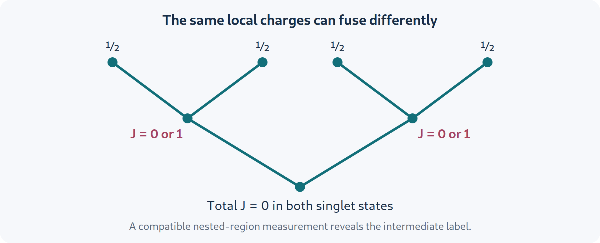

# Higher-form symmetry, intrinsic mixed order, and non-Abelian fusion {#sec-generalized-symmetry}

The examples so far involved a global operation acting on all sites and a charged operator localized near a point. Topological phases invite a broader language: the charged objects can be strings, and the symmetry operations can be deformable loops. Mixed states then support strong and weak versions of those generalized symmetries. A second generalization replaces Abelian charges by non-Abelian representations or anyons, whose combination requires fusion information beyond local labels.

These two generalizations are related but distinct. A non-Abelian ordinary symmetry such as $SU(2)$ is a group acting globally. A noninvertible higher-form symmetry has extended operators whose multiplication can be a sum of operators rather than another group element. We will develop both using explicit algebras, and retain the different assumptions behind the available classification proposals.

## What makes a symmetry higher form? {#sec-higher-form-definition}

An ordinary, or zero-form, symmetry acts on point-like charged operators. A one-form symmetry acts on line-like charged operators, such as Wilson loops. In $d$ spatial dimensions, its symmetry operator is supported on a closed surface of dimension $d-1$. Linking that surface with the charged line multiplies the line by a phase. In two spatial dimensions, both can be represented by loops, and their equal-time crossing algebra is especially easy to draw.

For a $\mathbb Z_2$ example, write a symmetry loop $U(\gamma)$ and a charged loop or string $W(\gamma')$. If they cross an odd number of times,

$$
U(\gamma)W(\gamma')=-W(\gamma')U(\gamma).
$$ {#eq-higher-crossing}

An even number gives a plus sign. “Topological” means that smoothly deforming the symmetry operator without crossing a charged insertion does not change its action on the relevant low-energy or constrained-state space. On a lattice this usually follows because two deformations differ by a product of local constraints.

This definition is more informative than simply calling a nonlocal conserved operator a higher-form symmetry. Its deformability, support dimension, action on extended charged objects, and allowed defects all matter. In a generic microscopic model these properties can be emergent at long distances rather than exact at every energy.

### Wilson loops and symmetry breaking

A conventional broken symmetry has a nondecaying correlator of two distant charged endpoints. For a one-form symmetry, the analogous order parameter is an extended charged loop. In a confining phase, a large Wilson loop often decays as $e^{-a\,\mathrm{Area}}$; in a deconfined phase, its leading local suppression is a perimeter term $e^{-b\,\mathrm{Perimeter}}$. After removing this short-distance boundary contribution, the loop can retain order. At an exactly solvable fixed point it can equal one.

These area/perimeter statements assume a setting where Wilson loops are appropriate diagnostics and dynamical screening is controlled. With fundamental matter, non-Abelian charges, or mixed-state channels, one must specify the operator and the symmetry being tested. A zero ordinary loop expectation may reflect noise in a microscopic representative rather than the disappearance of all dressed loop structure.

## The toric code's loop algebra {#sec-higher-toric-algebra}

Return to @eq-toric-hamiltonian. A closed direct-lattice $Z$ string $W_e(\gamma)=\prod_{a\in\gamma}Z_a$ and a closed dual-lattice $X$ string $W_m(\gamma^*)=\prod_{a\perp\gamma^*}X_a$ obey

$$
W_e(\gamma)W_m(\gamma^*)
=(-1)^{I(\gamma,\gamma^*)}W_m(\gamma^*)W_e(\gamma),
$$ {#eq-higher-toric-loops}

where $I$ counts intersections modulo two. A contractible $Z$ loop is a product of enclosed $B_f$; a contractible dual $X$ loop is a product of enclosed $A_v$. Deforming a path across a face or star therefore leaves its action unchanged in the code space.

The sign is the mutual braiding phase of $e$ and $m$. Transport an $e$ around an $m$, compare the order of their string operations, and the amplitude changes by $-1$. On a torus, crossing noncontractible loops act as conjugate logical Pauli operators.

A useful consistency check follows immediately. No nonzero density matrix can satisfy both $W_e\rho=\rho$ and $W_m\rho=\rho$ for two anticommuting loops. Applying their product in the two orders would imply $\rho=-\rho$. Thus a statement that a toric-code state has strong loop symmetries must identify which compatible loops and sectors are fixed; it cannot assign simultaneous sharp eigenvalues to every noncontractible logical loop.

The incompatibility is a manifestation of a mutual higher-form anomaly. It is encoded in an algebra of operators and survives many changes of microscopic Hamiltonian. Which part remains meaningful for mixed states depends on whether the operations are strong, weak, or dressed into channel symmetries.

## A classical loop ensemble calculated exactly {#sec-classical-loop-ensemble}

Write a link configuration as signs $z_a=\pm1$ in the $Z$ basis. The flatness condition is $\prod_{a\in\partial f}z_a=1$ on every face. On a torus, flat configurations have two winding holonomies $w_x,w_y=\pm1$ that cannot be changed by local star flips.

For fixed $w=(w_x,w_y)$, define

$$
\rho_w=\frac1{N_w}\sum_{z\,\mathrm{flat},\,\mathrm{hol}(z)=w}|z\rangle\langle z|.
$$ {#eq-higher-classical-sector}

This is a classical probability distribution written as a density matrix. It can be obtained by fully dephasing a corresponding toric-code wavefunction in the $Z$ basis. Since $V-1$ independent star flips generate every configuration in a fixed flat sector, $N_w=2^{V-1}$ on a connected square torus. Thus $S(\rho_w)=(V-1)\ln2$.

Every contractible $Z$ loop is strongly fixed at $+1$, and the two noncontractible $Z$ loops have sharp values $w_x,w_y$. Star operators permute configurations inside the sum, giving $A_v\rho_wA_v=\rho_w$. However, $A_v\rho_w\ne\rho_w$: left multiplication creates off-diagonal matrix elements absent from the diagonal state. The corresponding symmetry has become weak.

A noncontractible dual $X$ loop changes one holonomy and maps $\rho_w$ into a different sector. It is not a weak symmetry of a single fixed-$w$ state. The uniform mixture $\overline\rho=\tfrac14\sum_w\rho_w$ is invariant under those permutations, but it no longer fixes the individual noncontractible $Z$ holonomies strongly. This explicit example prevents an inconsistent assignment of all strong and weak loop conditions at once.

### Locally invisible, globally readable information

The four distributions $\rho_w$ have identical marginals on a small contractible region that does not wind around the torus. To see this, changing a winding sector can be accomplished by a dual $X$ loop placed outside that region; conjugation then changes the sector while leaving its reduced state unchanged. Nevertheless a noncontractible $Z$ measurement distinguishes the four sectors perfectly.

The convex family $\rho=\sum_w p_w\rho_w$ therefore stores two classical bits. It does not store arbitrary superpositions of the four original toric-code ground states, because dephasing removed the off-diagonal coherences. All spatial entanglement measures vanish for each $\rho_w$: the displayed decomposition is separable. Global conditional structure and local indistinguishability can survive without quantum entanglement.

This classical loop ensemble is an instructive separator of phase definitions. Under two-way channel connectivity it can be trivial in a sense that allows global recoverability without preserving every local operator relation. Under locally reversible channel circuits, its topological degeneracy and strong/weak loop structure are protected [@sang2025reversibility]. The change is in the equivalence relation, not in the elementary probability distribution.

## Nonlinear loop diagnostics {#sec-higher-nonlinear}

For an extended operator $W$ that is unitary, define

$$
F_W=F(\rho,W\rho W^\dagger),\quad
R_{1,W}=\tr(\sqrt\rho\,W\sqrt\rho\,W^\dagger),\quad
R_{2,W}=\frac{\tr(\rho W\rho W^\dagger)}{\tr\rho^2}.
$$ {#eq-higher-loop-diagnostics}

These measure indistinguishability under an insertion, rather than the ordinary expectation $\tr(\rho W)$. To formulate higher-form SW-SSB, choose the appropriate charged extended insertion and compare the nonlinear and ordinary large-distance or large-loop behavior. The geometry and perimeter renormalization must be included; replacing a point operator by any arbitrary long string does not automatically define an order parameter.

For a particularly transparent classical example, let $W=A_v$. In $\rho_w$, its ordinary expectation vanishes, while $A_v\rho_wA_v=\rho_w$, so all three quantities above equal one. This shows the algebraic strong-to-weak distinction for that operation. Because $A_v$ is local, it is not alone a thermodynamic one-form order parameter; an extended family and its deformation properties establish the generalized-symmetry interpretation.

In noisy topological states, different replica indices can again produce different transitions. The updated analysis of disordered toric-code ensembles in @zhang2025oneform explicitly uses a Rényi-2 finite-Markov-length equivalence when calling certain phases intrinsically mixed. A fidelity-based statement or a theorem under locally reversible physical channels requires the corresponding additional argument.

## Incoherent anyon proliferation versus coherent condensation {#sec-anyon-proliferation}

For Abelian anyons, let $M_{ab}$ be the phase from fully braiding $a$ around $b$. A boson can sometimes condense coherently in a pure state, identifying certain sectors with vacuum and confining sectors that braid nontrivially with it. A mixed-state channel can instead create a random distribution of anyon pairs. This **incoherent proliferation** need not satisfy the same rules as a coherent condensate.

Suppose noise proliferates an anyon set $\mathcal A$. A probe $b$ that braids nontrivially with that random background acquires fluctuating phases. Its coherent distinguishability can be lost. A natural surviving set is the commutant

$$
\mathcal A'=\{b: M_{ab}=1\ \text{for every }a\in\mathcal A\}.
$$ {#eq-higher-commutant}

This mechanism is realized in concrete decohered topological states and subsystem-code constructions [@sohal2025noisy; @ellison2025classification]. It is an organizing rule within those frameworks, not a complete classification of arbitrary noise-driven phases.

### Worked example: proliferating a toric-code fermion

The toric-code anyons are $1,e,m,f=e\times m$. Their spins are $\theta_e=\theta_m=1$, $\theta_f=-1$. Mutual braiding gives $M_{e,m}=-1$, and hence $M_{e,f}=M_{m,f}=-1$, while $M_{f,f}=1$. Incoherent $f$ proliferation can therefore leave the set $\{1,f\}$.

The surviving $f$ braids trivially with everything in that remaining set but has fermionic self-statistics. Such a transparent fermion makes the remaining braiding theory nonmodular: braiding alone does not distinguish all nontrivial sectors from vacuum. It cannot be treated as the complete modular anyon content of a conventional bosonic two-dimensional gapped pure ground state.

Mixed-state examples realizing this structure retain topological entanglement negativity while losing the original topological quantum memory [@wang2025intrinsic]. This shows why residual quantum entanglement and recoverable logical qubits are distinct. It also explains why calling the process ordinary condensation of a bosonic order parameter would miss the point: the proliferated excitation is fermionic, and the channel averages histories rather than preparing a coherent fermion condensate.

A **premodular** theory allows such transparent sectors; a modular theory has nondegenerate braiding. Proposed classifications of two-dimensional mixed topological orders by premodular data are powerful but partial or conjectural. Incoherent proliferation and classical gauging are mechanisms known to generate examples, not a proof that no additional mechanisms exist [@ellison2025classification].

### An ensemble criterion for long-range quantum structure

Another diagnostic asks whether $\rho$ admits any decomposition $\rho=\sum_ap_a|\psi_a\rangle\langle\psi_a|$ in which every component is short-range entangled. This is weaker than full separability into on-site product states: a short-range-entangled component can contain local Bell pairs or other entanglement removable by a bounded local unitary. It is also an existence question over all decompositions, rather than a statement about the experimentally selected trajectory ensemble. For locally decohered toric-code and X-cube models, explicit decompositions and statistical-mechanical mappings give evidence that such separability transitions coincide with optimal error-correction thresholds in the studied settings [@chen2024toposeparability]. That coincidence is not a universal equivalence between lost quantum memory and absence of all mixed-state entanglement. In particular, the fermion-proliferated examples above show why residual entanglement and the original logical memory need separate tests.

## Anomalies as entanglement obstructions {#sec-higher-anomaly}

The preceding classical loop example had global structure without entanglement. Strong anomalous higher-form symmetries can impose a stronger obstruction. In particular, nontrivial braiding or self-statistics can forbid preparing a state from short-range or separable resources by the relevant local channels. The intuition is locality: distant pieces of a would-be product preparation cannot reproduce a topologically invariant phase attached to intersecting extended operations unless the state already contains nonlocal quantum structure.

One proof strategy is symmetry pullback. Let a local channel map $\rho$ to $\sigma$, and suppose an extended operator is a strong symmetry of $\sigma$. Through a Stinespring dilation, pull its action backward to an operator on the input and local environment. Locality bounds the support thickening. If the channel class permits the required pullback, relations between intersecting symmetry operators, including their anomalous phase, are inherited by the input. A purported trivial input can then contradict that algebra.

The theorem's channel class matters. Stochastic local channels that mod out classical correlations support an entanglement-oriented phase definition; strong higher-form anomalies are stable under that definition. In $2+1$ dimensions they imply long-range bipartite entanglement and lower bounds on a topological entanglement-of-formation quantity [@lessa2025higher]. Higher-dimensional multipartite extensions are not all established by the same proof.

Independent higher-form anomaly arguments bound overlap with short-range-entangled states and construct a $3+1$-dimensional mixed order that violates the pure-state expectation of remote detectability [@hsin2025higher]. Remote detectability says, roughly, that a nontrivial excitation can be distinguished by a distant braiding experiment. If some detecting sectors have been erased by decoherence, an excitation may survive without that complete detector set. The pure-state consistency conditions must then be modified rather than silently assumed.

Weak symmetries need extra care. Their action can be stable as a **channel symmetry** after a locally reversible deformation even when no simple dressed unitary represents it. Local reversibility preserves more structure than two-way reachability of the global density matrix [@sang2025reversibility]. Consequently, entanglement classifications that intentionally discard classical information and phase classifications that preserve classical topological memories should not be presented as competing answers to one identical question.

## Noninvertible higher-form operations {#sec-noninvertible}

A group symmetry operator has an inverse. Anyon line operators in a non-Abelian topological theory instead obey fusion rules

$$
W_aW_b=\sum_cN_{ab}^{c}W_c.
$$ {#eq-higher-fusion-algebra}

The nonnegative integers $N_{ab}^{c}$ count fusion channels. When several $c$ appear, the operation is not invertible in the group sense. Calling it a symmetry requires its topological action and fusion algebra, not unitarity of every $W_a$.

For finite-group quantum doubles $D(G)$, excitations include flux and representation data. Decoherence can convert quantum locally indistinguishable sectors into a convex set of classical sectors. In the quantum-double constructions of @song2025quantumdouble, the number of extremal density matrices in the resulting information convex equals the pure ground-state degeneracy. A convex combination of $D$ independent extremal points has affine dimension $D-1$, so “number of extrema” and “dimension of the convex set” must not be interchanged.

An **information convex** is the set of density matrices compatible with specified local reduced-state constraints. Its shape tells us what global information remains hidden from those local measurements. A simplex signals classical alternatives; a full matrix-state space permits coherent quantum alternatives. More complicated non-Abelian structures can impose recovery and secret-sharing constraints not visible in a count of sectors alone. Axiomatic approaches based on local recoverability, short-range ordinary correlations, and spatial uniformity develop these distinctions systematically [@yang2026bootstrap].

## Non-Abelian ordinary symmetry needs fusion records {#sec-nonabelian-charge}

For an ordinary non-Abelian group, the Hilbert space decomposes as

$$
\mathcal H=\bigoplus_\lambda V_\lambda\otimes M_\lambda,
\qquad
U_g=\bigoplus_\lambda D_\lambda(g)\otimes I_{M_\lambda}.
$$ {#eq-higher-irrep-decomposition}

$V_\lambda$ carries an irreducible representation and $M_\lambda$ is its multiplicity space. A weakly invariant density matrix is proportional to identity on each $V_\lambda$ factor, with arbitrary positive operators on multiplicity spaces. The strict strong condition $U_g\rho=\chi(g)\rho$ for every $g$ requires support in a common one-dimensional representation. For $SU(2)$ this means the singlet sector. One should not replace that condition by “fixed spin $j$” for $j>0$.

Local regions can each carry nontrivial irreps even when the whole system is a singlet. Combining those irreps requires a fusion tree. For $SU(2)$,

$$
j_1\otimes j_2=\bigoplus_{J=|j_1-j_2|}^{j_1+j_2}J.
$$

Knowing $j_1,j_2$ does not determine $J$. That ambiguity has operational consequences for a decoder.

### Worked example: four spin halves

Each site has fixed local spin $1/2$. Four sites contain two independent total singlets. In one basis they are

$$
|\alpha\rangle=|s_{12}\rangle|s_{34}\rangle,
$$

and

$$
|\beta\rangle=\frac1{\sqrt3}
\left(|t_+\rangle_{12}|t_-\rangle_{34}
-|t_0\rangle_{12}|t_0\rangle_{34}
+|t_-\rangle_{12}|t_+\rangle_{34}\right).
$$ {#eq-higher-four-spin}

Here $s=(|\uparrow\downarrow\rangle-|\downarrow\uparrow\rangle)/\sqrt2$, $t_\pm=|\uparrow\uparrow\rangle,|\downarrow\downarrow\rangle$, and $t_0=(|\uparrow\downarrow\rangle+|\downarrow\uparrow\rangle)/\sqrt2$. Every one-site Casimir has the same value $3/4$ in both states. The total Casimir also vanishes in both. Yet measuring the two-site Casimir $(\mathbf S_1+\mathbf S_2)^2$ distinguishes them: $J_{12}=0$ for $\alpha$ and $J_{12}=1$ for $\beta$.

Thus neither the local irrep list nor the total charge specifies how charges fused. A decoder retaining nested-region fusion outcomes can know more than one retaining only the smallest-region labels. Measuring incompatible fusion trees can disturb the state, so a hierarchy must specify a compatible measurement protocol rather than assume all fusion data are simultaneously available.

{#fig-fusion-records width="100%"}

## A maximally mixed state can retain quantum entanglement {#sec-singlet-entanglement}

The four-spin example generalizes to an instructive stationary ensemble. Let $P_0$ project $N$ spin halves onto total spin zero, and take $\rho_0=P_0/\tr P_0$. A unital strongly $SU(2)$-symmetric channel preserves this state; if it mixes within the singlet sector with no further invariant subspaces, this is the sector's unique stationary state. Unitality and strong symmetry alone do not guarantee that mixing hypothesis.

Partition the spins into two macroscopic regions. Write $m_A(j)=\dim M^A_j$ and $m_B(j)=\dim M^B_j$. A total singlet requires equal spins $j$ on the two sides. There is one singlet $|S_j\rangle$ in $V_j\otimes V_j$, maximally entangled with Schmidt rank $d_j=2j+1$. Multiplicity spaces need no entanglement. Hence

$$
\rho_0=\bigoplus_j p_j\,
|S_j\rangle\langle S_j|\otimes
\frac{I_{M^A_j}}{m_A(j)}\otimes\frac{I_{M^B_j}}{m_B(j)},
\quad
p_j=\frac{m_A(j)m_B(j)}{\sum_lm_A(l)m_B(l)}.
$$ {#eq-higher-singlet-blocks}

The label $j$ is readable independently on each side by a local total-spin measurement. Conditional on it, all quantum entanglement resides in $|S_j\rangle$. The multiplicity factors are product mixed states.

Entanglement of formation $E_F$ is the minimum average pure-state entanglement over convex decompositions. Distillable entanglement $E_D$ is the asymptotic singlet yield under local operations and classical communication. For this state, measuring the locally accessible $j$ flag and retaining $|S_j\rangle$ gives a yield $\sum_jp_j\ln d_j$. Conversely, the displayed block decomposition, with product-basis decompositions of its multiplicity factors, attains that same average formation cost. Since $E_D\leq E_F$, the two bounds meet:

$$
E_D(\rho_0)=E_F(\rho_0)=\sum_jp_j\ln(2j+1).
$$ {#eq-higher-singlet-entanglement}

These measures use ordinary unrestricted bipartite operations; imposing additional local symmetry or reference-frame restrictions would define a different operational resource theory. The logarithmic negativity, $E_{\mathcal N}=\ln\|\rho_0^{T_B}\|_1$, follows because the partially transposed rank-$d_j$ singlet has trace norm $d_j$, while the flags occupy orthogonal blocks:

$$
E_{\mathcal N}(\rho_0)=\ln\sum_jp_j(2j+1).
$$ {#eq-higher-singlet-negativity}

The four-spin equal mixture of $\alpha$ and $\beta$ has $p_0=p_1=1/2$, giving $E_D=E_F=\tfrac12\ln3$ and $E_{\mathcal N}=\ln2$. These are measures of the mixed state itself, not averages over a chosen trajectory ensemble.

For an even block of $n$ spin halves, the multiplicity is

$$
m_n(j)=\binom{n}{n/2-j}-\binom{n}{n/2-j-1}.
$$

This follows by subtracting the number of states with magnetization $j+1$ from those with magnetization $j$: every spin-$J\geq j+1$ irrep contributes to both, while spin $j$ contributes only to the latter. Stirling's approximation for two blocks each containing a fixed fraction of $N$ gives typical $j\sim\sqrt N$. Thus both formulas above grow as $\tfrac12\ln N+O(1)$ for this spin-half singlet family. A fixed-size block cannot show that growth because its accessible $j$ is bounded.

The representation-theoretic entanglement mechanism is established for broad invariant-sector ensembles [@moharramipour2024entanglement], and exact negativity results extend to non-Abelian symmetries and more general commutant structures [@li2025stationary]. In contrast, an Abelian on-site charge constraint admits a product charge-basis decomposition of its maximally mixed sector state. Strong non-Abelian symmetry can therefore enforce quantum entanglement even when the ensemble is otherwise maximally mixed. This is a concrete limit of interpreting all charge thermalization as classical diffusion.

## Center ordering and a decoding hierarchy {#sec-fusion-frontier}

The October 2026 work @sala2026fusion formulates non-Abelian SW-SSB as distinguishability between strongly symmetric states differing by a pair of inserted irreps after symmetric decoherence. For finite $G$, it relates the task to decoding a quantum double $D(G)$ under pure-charge noise. Nested-region fusion records produce a hierarchy of statistical-mechanics decoding problems with Nishimori-like disorder matching.

The **center** $Z(G)$ consists of group elements commuting with every $g\in G$. By Schur's lemma, a center element acts within an irrep as a scalar. It therefore supplies an Abelian label that survives some ambiguity of non-Abelian fusion. For $SU(2)$, the center is $\{I,-I\}$ and acts as $(-1)^{2j}$: integer and half-integer spins have opposite center charge. For $S_3$, the center is trivial.

At finite levels of that decoding hierarchy, under its stated group assumptions, noncentral representation information can hide in noise-generated fusion channels. The surviving nonzero-noise ordering transition is associated with the center. The paper establishes specific finite-level statements for nonnilpotent groups and tests $S_3$ and $SU(2)$ with tensor-network calculations. In the $SU(2)$ example the center transition is consistent with Nishimori-Ising universality, and a second-level decoder raises the threshold by about 16 percent relative to the first. These finite-level results are not a proof of the threshold of an unrestricted optimal decoder with unlimited fusion information.

The monotonic direction has a simple information-theoretic proof. If a higher-level record contains the lower-level record, a decoder can ignore the extra information and reproduce its earlier performance. Optimal success therefore cannot decrease. That statement is rigorous independently of the numerical threshold improvement. It does not determine whether the hierarchy converges quickly, or whether a finite level captures all thermodynamic information.

## Connecting the frameworks without collapsing them {#sec-higher-frameworks}

Higher-form order generalizes point-charge order to strings and surfaces. Anomalies encode their intersection phases. Topological error correction asks which globally indistinguishable sectors and coherent logical algebras survive noise. Non-Abelian fusion enriches what a syndrome must record. These connections explain why statistical mechanics, symmetry, and quantum information recur together.

Several unresolved questions remain precise. Which invariants are complete under locally reversible circuits? How do stochastic-channel entanglement classes map onto classifications retaining classical memories? When can a Rényi-2 transition be promoted to a stable fidelity-based statement? What is the optimal fusion decoder beyond finite hierarchy levels? How much anomaly data is experimentally accessible through local regions? Each asks about a specified operation or diagnostic; none is answered by naming a single universal “mixed-state topology.”

## Exercises and worked solutions {#sec-higher-exercises}

### Exercise 1: crossing loops and sharp sectors

Let Hermitian unitaries $A,B$ anticommute. Show that a state with $A\rho=\rho$ has $\tr(\rho B)=0$ and $F(\rho,B\rho B)=0$.

::: {.callout-note collapse="true" title="Worked solution"}
The support of $\rho$ lies in the $A=+1$ subspace. Anticommutation sends that support into $A=-1$ after applying $B$. The two supports are orthogonal, so the fidelity vanishes. Also $\tr(\rho B)=\tr(A\rho A B)=-\tr(\rho B)$ and hence is zero. This is the same support argument used for charged local operators, now applied to a crossing logical loop.
:::

### Exercise 2: classical-sector entropy

For $\rho=\sum_w p_w\rho_w$ in @eq-higher-classical-sector, compute the entropy and the Holevo information available to an observer receiving the whole lattice.

::: {.callout-note collapse="true" title="Worked solution"}
Different $w$ sectors have disjoint support. Therefore $S(\rho)=H(p)+\sum_wp_wS(\rho_w)=H(p)+(V-1)\ln2$. The Holevo information of the ensemble is $S(\rho)-\sum_wp_wS(\rho_w)=H(p)$. Measuring both winding holonomies attains it. A contractible local observer obtains identical marginals for every $w$, so its Holevo information is zero. Global classical information is present without spatial quantum entanglement.
:::

### Exercise 3: surviving anyons

In the toric code, find the commutant of $\{1,e\}$ and compare it with the commutant of $\{1,f\}$.

::: {.callout-note collapse="true" title="Worked solution"}
$e$ braids trivially with $1,e$ and nontrivially with $m,f$, so the first commutant is $\{1,e\}$. Similarly $f$ braids trivially with $1,f$ and nontrivially with $e,m$, so the second is $\{1,f\}$. The first has a transparent boson, the second a transparent fermion. The common word “transparent” refers to mutual braiding within the surviving set; the self-statistics still distinguishes them.
:::

### Exercise 4: more records cannot worsen optimal decoding

Suppose $X$ is a coarse syndrome record, $Y$ an additional fusion record, and $H$ the hidden logical class. Prove $\sum_{x,y}\max_hP(h,x,y)\geq\sum_x\max_hP(h,x)$.

::: {.callout-note collapse="true" title="Worked solution"}
For each fixed $x$, let $h_x$ maximize $P(h,x)=\sum_yP(h,x,y)$. Then $\sum_y\max_hP(h,x,y)\geq\sum_yP(h_x,x,y)=\max_hP(h,x)$. Sum over $x$. Operationally, a decoder with $(X,Y)$ can ignore $Y$. The result requires actual inclusion of records; two incompatible measurement schemes are not automatically ordered this way.
:::

### Exercise 5: count four-spin singlets

Use angular-momentum addition to count total singlets of four spin halves and relate the count to @eq-higher-four-spin.

::: {.callout-note collapse="true" title="Worked solution"}
Group the spins into pairs. Each pair has $\tfrac12\otimes\tfrac12=0\oplus1$. The product $(0\oplus1)\otimes(0\oplus1)$ contains a singlet once in $0\otimes0$ and once in $1\otimes1=0\oplus1\oplus2$. Thus the singlet multiplicity is two, represented by $\alpha$ and $\beta$. Their distinction lies in an intermediate fusion label despite identical one-site and total irreps.
:::
