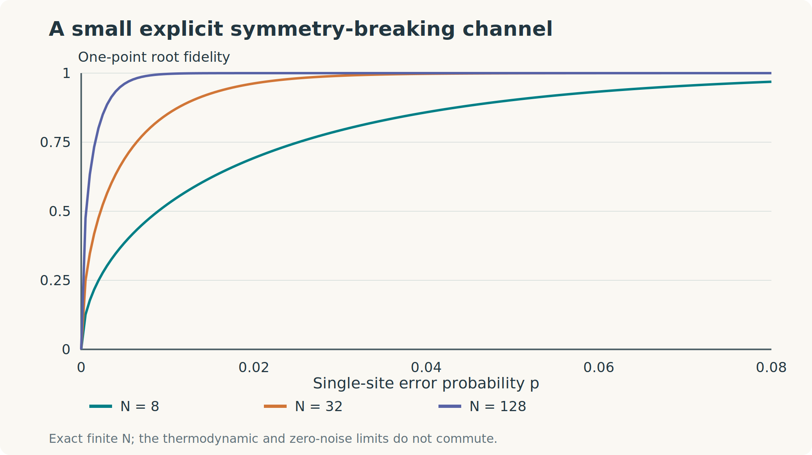
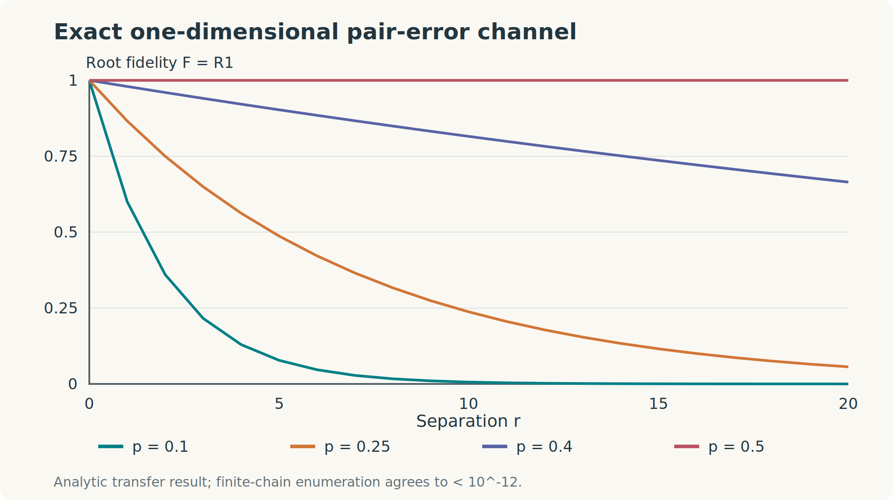
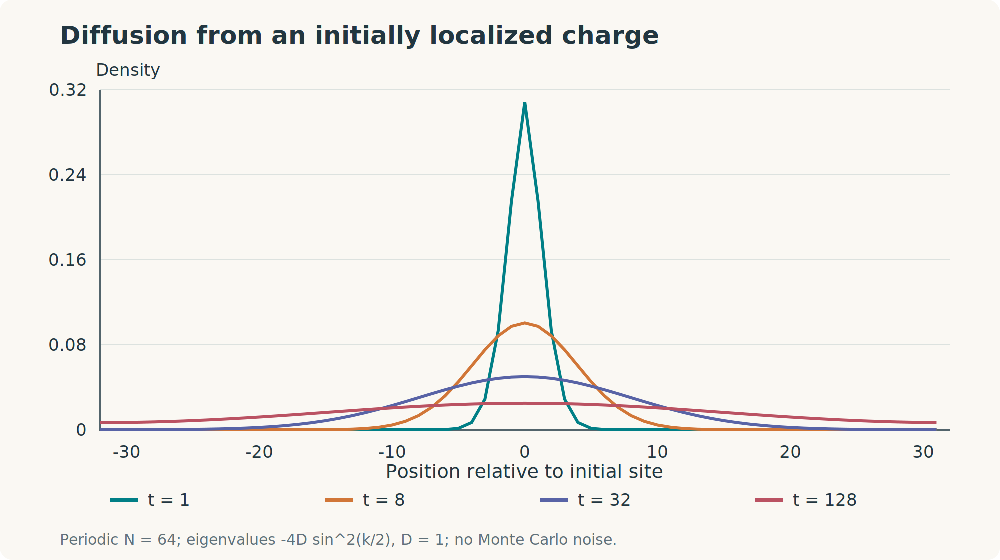
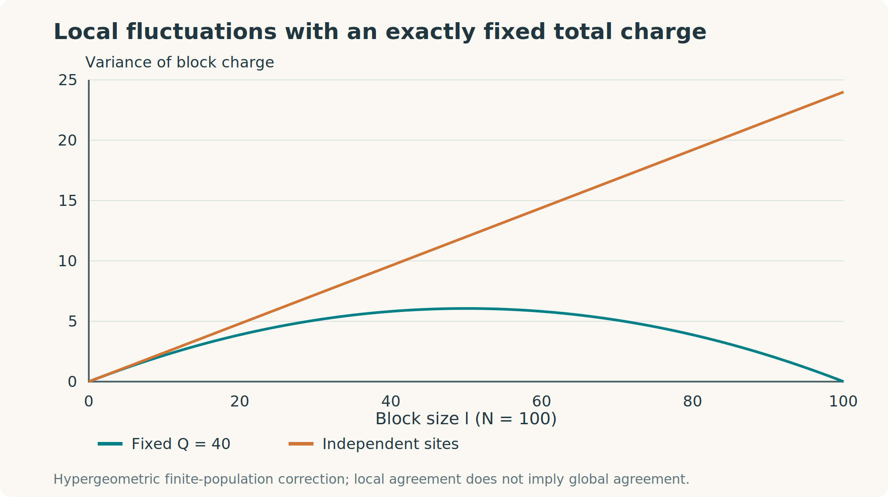

# Computational laboratory {#sec-laboratory}

## What a small calculation can establish

A numerical demonstration should connect a definition to a calculation that a reader can reproduce. It should also make its limitations visible. Exact diagonalization of eight spins can establish an algebraic identity for those eight spins, test an implementation, or reveal a useful trend. It cannot establish a thermodynamic phase by itself.

This laboratory contains five connected demonstrations: an exact parity response, independent pair errors on a chain, small periodic square lattices, noncommuting mixed-state overlaps, and diffusion. The calculations use Julia's standard libraries. The source, CSV data, and original vector figures are available with the book.

Run from the repository root:

```bash
julia --project=numerics numerics/generate.jl
```

No external Julia packages are required. The script fixes the random seed for its single random-matrix example. All other results are deterministic enumeration, analytic formulas, or exact Fourier sums. Figure conversion is separate from the physics calculation:

```bash
python3 -m pip install cairosvg
python3 scripts/convert_figures.py
```

The generated tables are in `numerics/data/`. The root-fidelity convention is the one defined in @eq-root-fidelity.

## A global parity bit under weak-only noise

Begin with the exactly strongly symmetric state $\rho_+=(I+U)/2^N$, $U=\prod_iX_i$. Apply independent single-site $Z_i$ errors with probability $p$. Since $Z_iUZ_i=-U$, each site attenuates the coefficient of $U$ by $1-2p$. Thus

$$
\rho(p)=\frac{I+\lambda U}{2^N},\qquad
\lambda=(1-2p)^N.
$$ {#eq-lab-lambda}

For $p>0$ in the chosen range, this output has both global parity sectors and is only weakly symmetric. We are studying the explicit symmetry-breaking response of an initially SW-ordered state, not declaring every point of this path strongly symmetric.

Conjugating by one $Z_i$ exchanges the two sectors. Their total probabilities are $(1\pm\lambda)/2$, uniformly distributed within each sector. Applying the classical fidelity formula gives

$$
F(\rho(p),Z_i\rho(p)Z_i)=\sqrt{1-\lambda^2}.
$$ {#eq-lab-one-point}

For every proper region the state is maximally mixed. The full entropy is $(N-1)\ln2+h((1+\lambda)/2)$, where $h(x)=-x\ln x-(1-x)\ln(1-x)$. Therefore a nonempty tripartition covering the whole system has

$$
I(A:C|B)=\ln2-h\left(\frac{1+\lambda}{2}\right).
$$ {#eq-lab-cmi}

For fixed $N$, the one-point fidelity tends to zero as $p\to0$. For every fixed $p>0$, it tends to one as $N\to\infty$. This exact calculation exposes the noncommuting limits without a fit.

::: {.content-visible when-format="html"}
<div class="lab-panel" id="parity-lab">
<h3>Explore the parity response</h3>
<div class="lab-controls">
<label>Number of sites N = <output data-size></output><input aria-label="Number of sites" name="size" type="range" min="8" max="512" step="8" value="64"></label>
<label>Single-site noise p = <output data-noise></output><input aria-label="Single-site noise probability" name="noise" type="range" min="0" max="0.05" step="0.0005" value="0.005"></label>
</div>
<div class="lab-results" aria-live="polite"><div><span>Global parity expectation λ</span><strong data-lambda></strong></div><div><span>One-point root fidelity</span><strong data-f></strong></div><div><span>Full-system CMI (bits)</span><strong data-cmi></strong></div></div>
<p data-status></p>
</div>
:::

{#fig-parity-response}

The small-$p$ response is nonanalytic if expressed directly in root fidelity: for fixed finite $N$, $\lambda\simeq1-2Np$ and $F\simeq2\sqrt{Np}$. A finite linear susceptibility should therefore specify whether the response variable is $F$, $F^2$, or a reparameterized channel strength. Never differentiate a convention borrowed from a paper without checking that convention.

## Exact pair-error enumeration on a chain

Now use a strongly symmetric channel. The input is $\ket+^{\otimes N}$, and each nearest-neighbor bond independently applies $Z_iZ_{i+1}$ with probability $p$. Label an $X$-basis spin configuration by an integer $s$, with bit one indicating $X_i=-1$. A bond error toggles two bits. Consequently every occupied output configuration has even parity.

The full output is diagonal in this basis. There is no need to store a $2^N\times2^N$ matrix. Store its $2^N$ probabilities instead. Each bond updates them as

$$
P_{\mathrm{new}}(s)=(1-p)P(s)+pP(s\oplus m_{ij}),
$$

where $m_{ij}$ has bits $i,j$ set and $\oplus$ denotes exclusive-or. The Julia implementation is short:

```julia
function bond_distribution(N, edges, p)
    P = zeros(2^N)
    P[1] = 1
    for (i, j) in edges
        mask = (1 << (i-1)) ⊻ (1 << (j-1))
        P = [(1-p)*P[s+1] + p*P[(s⊻mask)+1]
             for s in 0:2^N-1]
    end
    P
end
```

The pair insertion $A=Z_iZ_j$ shifts the distribution by $m_{ij}$. For commuting states,

$$
F_{ij}=R_{1,ij}=\sum_s\sqrt{P(s)P(s\oplus m_{ij})},\qquad
R_{2,ij}=\frac{\sum_sP(s)P(s\oplus m_{ij})}{\sum_sP(s)^2}.
$$ {#eq-lab-enumeration}

An open chain has no bond cycles. Each allowed even spin configuration corresponds to exactly one bond-error pattern. Flipping the two endpoints of an interval toggles the $r$ bonds inside it. The classical overlap factorizes over those bonds:

$$
F(r)=R_1(r)=[2\sqrt{p(1-p)}]^r,
\qquad
R_2(r)=\left[\frac{2p(1-p)}{p^2+(1-p)^2}\right]^r.
$$ {#eq-lab-chain}

The script verifies these formulas for $N=4,6,8$, all allowed separations, and five noise strengths, including both endpoints. Agreement is checked to absolute tolerance $10^{-12}$. It separately verifies normalization and the absence of odd-parity support.

::: {.content-visible when-format="html"}
<div class="lab-panel" id="chain-lab">
<h3>Explore the exact chain correlators</h3>
<div class="lab-controls">
<label>Pair-error probability p = <output data-p></output><input aria-label="Pair-error probability" name="pairnoise" type="range" min="0" max="0.5" step="0.01" value="0.25"></label>
<label>Separation r = <output data-r></output><input aria-label="Separation" name="distance" type="range" min="1" max="64" step="1" value="8"></label>
</div>
<div class="lab-results" aria-live="polite"><div><span>F = R1</span><strong data-f></strong></div><div><span>R2</span><strong data-r2></strong></div><div><span>Fidelity correlation length</span><strong data-xi></strong></div></div>
<p>For every p below 1/2 the infinite chain has finite overlap correlation length. At p = 1/2 the output is the fixed-parity maximally mixed state.</p>
</div>
<script src="assets/lab.js"></script>
:::

{#fig-chain-overlaps}

For $0<p<1/2$, $\xi_F^{-1}=-\ln[2\sqrt{p(1-p)}]$. Write $p=1/2-\delta$. Then $2\sqrt{p(1-p)}=\sqrt{1-4\delta^2}$, so $\xi_F\simeq1/(2\delta^2)$. The divergence at complete dephasing is quadratic in the inverse distance to that endpoint. Translating $p$ to time via continuous pair dephasing produces an exponentially growing information length in this discrete-symmetry model. That is different from the continuous-charge models where other growth laws arise.

## What changes on a square lattice?

The same update rule works on any graph. On a periodic square lattice, different bond configurations can have the same boundary because they differ by closed loops. The unique-pattern factorization used for the chain is lost. Summing over those loops is precisely the statistical-mechanical problem underlying the two-dimensional transition.

The data file `square-finite.csv` contains exact $L=3,4$ periodic-lattice results at selected $p$ values. For these small sizes, all probabilities are explicitly represented; there is no sampling error. There is substantial finite-size error if one tries to infer an infinite-lattice threshold. The numbers near $0.109$ and $0.178203$ are included to compare with the independently derived fidelity and Rényi-2 transition values discussed in the decoherence chapter, not to remeasure those thresholds.

A meaningful scaling study would require sizes larger than the critical correlation length, observables with a controlled scaling form, uncertainty from both statistics and finite-size corrections, and an explicit choice of diagnostic. Crossing curves of $F$ and $R_2$ on sixteen spins cannot establish a common phase boundary.

## A noncommuting example: the correlators differ

Equality $F=R_1$ above follows from simultaneous diagonalization. It is not a universal identity. The script constructs a positive random matrix $MM^\dagger$, normalizes it, and embeds it in the even-$X$ sector of four spins. With $A=Z_1Z_2$, it evaluates

$$
F_A=\|\sqrt\rho A\sqrt\rho\|_1,\quad
R_{1,A}=\operatorname{Tr}(\sqrt\rho A\sqrt\rho A^\dagger),\quad
R_{2,A}=\frac{\operatorname{Tr}(\rho A\rho A^\dagger)}{\operatorname{Tr}\rho^2}.
$$

Matrix square roots come from the Hermitian eigenvalue decomposition. Tiny negative eigenvalues from rounding are clipped only at zero after positivity is guaranteed by the construction. Trace norms come from singular values. The output is recorded in `noncommuting.csv`, including the seed. The checked bounds are

$$
R_1\leq F\leq\sqrt{R_1}.
$$

These inequalities concern normalized states and unitary insertions. They do not provide a dimension-independent equivalence between $R_2$ and $F$. Nor does a four-site noncommuting example establish spontaneous order: there is no long-distance limit in that calculation. Its purpose is to test the definitions and implementation.

## Diffusion: an exact conservation check

For a single particle hopping symmetrically on a periodic chain at rate $D$,

$$
\dot n_x=D(n_{x+1}+n_{x-1}-2n_x).
$$

The Fourier mode $e^{ikx}$ has eigenvalue $-4D\sin^2(k/2)$. Starting from $n_x(0)=\delta_{x0}$, the exact solution is

$$
n_x(t)=\frac1N\sum_{m=0}^{N-1}
e^{-4D\sin^2(\pi m/N)t}e^{2\pi imx/N}.
$$ {#eq-lab-diffusion}

The zero mode stays constant, ensuring $\sum_xn_x(t)=1$. For long wavelengths and times shorter than the finite-size equilibration time, the profile approaches a Gaussian of width $\sqrt{2Dt}$. The script checks normalization and positivity at all displayed times. For the symmetric exclusion process, the same linear equation holds exactly for the mean density even though the many-particle probability distribution has interactions through exclusion.

{#fig-diffusion}

This plot demonstrates diffusion, not SW-SSB by itself. To diagnose SW-SSB in a stationary charge-conserving many-body ensemble, one must also evaluate the nonlinear charge-transfer correlators and their limits.

## Canonical block fluctuations

The last figure compares the exact hypergeometric variance from @eq-hypergeom-variance with its independent-site grand-canonical counterpart. At fixed small block size they agree as $N$ grows. At the full system size the canonical variance vanishes.

{#fig-block-variance}

Extensive variance on small fractions of the system is consistent with a globally sharp charge. Conversely, extensive block variance alone does not establish SW-SSB. The charge-scrambling chapter develops explicit reasons why both directions of an unconditional equivalence fail.

## Exercises and worked solutions

### 1. Verify the strong-breaking response

Show that $\operatorname{Tr}(\rho(p)U)=\lambda$ and that the one-point fidelity in @eq-lab-one-point is maximal when this global parity expectation vanishes.

::: {.callout-note collapse="true" title="Solution"}
The identity part has zero trace against $U$, while $U^2=I$ gives $\operatorname{Tr}(\lambda U^2/2^N)=\lambda$. The fidelity is $\sqrt{1-\lambda^2}$, maximal at $\lambda=0$. This is a relation between a nonlocal linear observable and a nonlinear local-operation overlap for this special family, not a general identity for all mixed states.
:::

### 2. Why is the open-chain map injective?

Given endpoint spin flips $s_i$, reconstruct the bond-error bits $e_i$ on an open chain. Explain the even-parity constraint.

::: {.callout-note collapse="true" title="Solution"}
The boundary equations are $s_1=e_1$, $s_i=e_{i-1}\oplus e_i$ for interior sites, and $s_N=e_{N-1}$. Thus $e_i=s_1\oplus\cdots\oplus s_i$ is unique. The last equation holds precisely when $\bigoplus_i s_i=0$. Adding a cycle destroys uniqueness because toggling every edge of the cycle leaves the boundary unchanged.
:::

### 3. Extract a length without fitting

Derive the asymptotic divergence of $\xi_F$ near $p=1/2$ and compare it with $\xi_2$.

::: {.callout-note collapse="true" title="Solution"}
With $\delta=1/2-p$, $a_F=\sqrt{1-4\delta^2}=1-2\delta^2+O(\delta^4)$, so $\xi_F\simeq1/(2\delta^2)$. The Rényi-2 base is $(1-4\delta^2)/(1+4\delta^2)=1-8\delta^2+O(\delta^4)$, so $\xi_2\simeq1/(8\delta^2)$. They diverge at the same endpoint in this chain but have different lengths. Their common endpoint is not evidence that all dimensions or models share the same transitions.
:::

### 4. The diffusion equilibration time

Find the slowest nonzero Fourier decay rate for the periodic chain and its large-$N$ scaling.

::: {.callout-note collapse="true" title="Solution"}
The $m=1,N-1$ modes have rate $4D\sin^2(\pi/N)\simeq4\pi^2D/N^2$. Thus the inverse spectral rate scales as $N^2/(4\pi^2D)$. A specified mixing error can introduce logarithmic factors. The conserved zero mode is excluded from the gap rather than treated as a slowly decaying fluctuation.
:::

### 5. Design a useful numerical extension

How would you test the difference between a local SW diagnostic and a global finite-sector diagnostic on the parity family?

::: {.callout-note collapse="true" title="Solution"}
Compute the full one-point fidelity, then trace out one site and recompute it on the remaining state. For the exact fixed-parity input, the full one-point fidelity is zero because the charge sectors are orthogonal. The reduced state is maximally mixed, so its one-point fidelity is one. Repeat while varying the region and total size separately. The calculation reveals a difference in which information is retained, rather than a numerical inconsistency between two implementations.
:::
