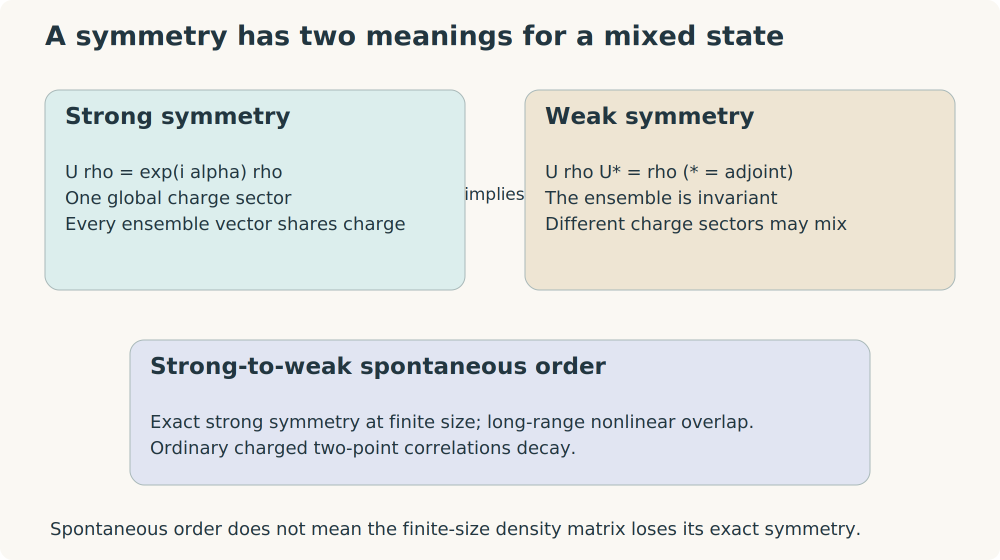

# Welcome {.unnumbered}

::: {.content-visible when-format="html"}
::: {.book-hero}

QUANTUM MATTER · INFORMATION · OPEN SYSTEMS

<h1>When symmetry survives, but its information changes.</h1>

Strong-to-Weak Spontaneous Symmetry Breaking: From Fundamentals to Research Frontiers.

A self-contained route from density matrices to mixed-state phases, quantum error correction, and emergent hydrodynamics.

<a class="btn btn-primary" href="01-quantum-language.html">Begin with the foundations →</a> <a class="btn btn-outline-secondary" href="19-literature-map.html">Explore the literature map</a>

:::
:::

## The question that organizes the book

Consider $N$ spins with global spin flip $U=\prod_iX_i$. The mixed state

$$
\rho_+=\frac{I+U}{2^N}
$$

has a definite global symmetry charge. It has no ordinary spin order: $\operatorname{Tr}(\rho_+Z_iZ_j)=0$ for distinct sites. Yet applying $Z_iZ_j$ at arbitrarily distant points leaves it unchanged. Erasing even one spin loses a global bit that cannot be restored while leaving a distant region untouched. The state is separable, but its information is organized across the entire system.

Strong-to-weak spontaneous symmetry breaking gives a language for this phenomenon and for much less elementary states. Its central question is not only whether a symmetry is present, but how its charge is encoded, what local operations can reveal or erase, and which information structures persist under dynamics.

{#fig-symmetry-map}

## What you will learn

The first part develops the tools rather than assuming them: density matrices, statistical ensembles, conventional SSB, quantum channels, Lindblad dynamics, fidelity, entropy, conditional mutual information, and recovery. The second part derives the nonlinear diagnostics, purification constructions, stability arguments, and solvable decoherence models. The third connects these ideas to error correction, topology, SPT phases, generalized symmetries, diffusion, charge scrambling, information-critical behavior, and experiments. The final part provides reproducible Julia calculations, research projects, and an annotated source map.

Each chapter contains worked examples and exercises with solutions. Derivations distinguish exact finite-size identities, asymptotic arguments, model-dependent numerical findings, and conjectures. The numerical laboratory uses exact enumeration and standard-library Julia; no package installation is needed for the calculations.

## Reading routes

| Your starting point | A useful route |
|:--|:--|
| First course in quantum mechanics and statistical mechanics | Read Chapters 1–9 in order; work the exercises before entering the research chapters. |
| Comfortable with open systems and quantum information | Review the conventions below, then begin with symmetry in Chapter 5. |
| Interested in decoherence and quantum memories | Chapters 5–10, then information-critical phases and the computational laboratory. |
| Interested in transport and thermalization | Chapters 5–8, then hydrodynamics and charge scrambling. |
| Interested in mixed-state topology | Chapters 5–8 and 10–12; pay particular attention to the chosen phase equivalence. |
| Planning a project | Read the synthesis and source map after the relevant derivation chapters; use their assumptions as a checklist for a precise question. |

The appendices supply matrix inequalities, vectorization rules, Fourier conventions, a notation guide, and a glossary. Cross-references connect prerequisites to their later use. The sidebar search includes the chapter text and bibliography. A combined PDF is available from the download control.

## Conventions that prevent common confusions

We set $\hbar=k_B=1$ and use natural logarithms unless bits are specified. $F(\rho,\sigma)$ is **root fidelity**, not its square. The canonical purification is $\ket{\sqrt\rho}\!\rangle$; the normalized vectorization $\ket\rho\!\rangle/\sqrt{\operatorname{Tr}\rho^2}$ is a different doubled state. Rényi-1 and Rényi-2 correlators refer to these different constructions.

“Strong symmetry” of a state means support in a single symmetry-charge sector, when that finite-volume description applies. “Strong symmetry” of a channel means that its local operations preserve that charge. Neither phrase follows from covariance alone. Global and local SW-SSB formulations are distinguished throughout: an exact finite-size charge constraint can disappear from the algebra of all finite-region observables in the infinite-volume limit.

A phase statement always depends on the allowed operations. Strongly symmetric shallow channels, two-way channel connectivity, and locally reversible channels impose different conditions. Thresholds extracted from nonlinear replicas need not be intrinsic phase boundaries.

## Scope and source method

The literature search begins with Chong Wang's June 2026 review, *Strong-to-Weak Spontaneous Symmetry Breaking*, and traces its primary sources backward and newer work forward. Coverage is frozen at **22 October 2026**. The review is a guide to the field, while the derivations here are organized by physical concepts. Essential calculations are developed in the chapters rather than delegated to references. The source map records which papers support each connection and where the distinctions remain unsettled.

The newest experiments and theoretical frameworks are treated at their demonstrated scope. A finite processor can show signatures and finite-size scaling; an exact thermodynamic theorem is a different kind of evidence. A field this active has competing definitions and useful counterexamples. Understanding those boundaries is part of mastering the subject.
